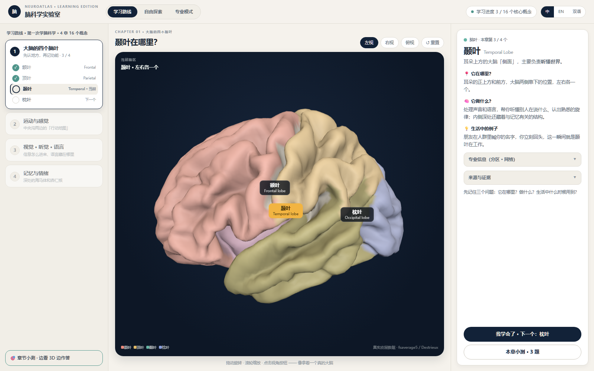
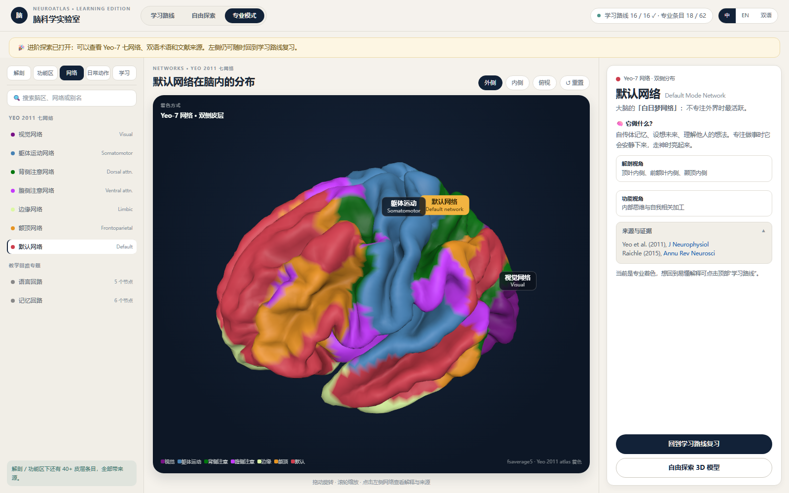

# 🧠 NeuroAtlas · Learning Edition · 脑科学实验室

### Learn the brain by looking at it, turning it and testing yourself. / 看见大脑、转动大脑，再用问题把理解留下来。

**融合版交互演示 · Merged interactive demo** — a browser-based 3D brain-science learning lab that brings guided learning, free exploration, deep-structure views, chapter quizzes and professional network visualisation into one coherent experience.

一个可以直接在浏览器中运行的三维脑科学学习实验室：把学习路线、自由探索、深部结构透视、章节小测和专业网络视图融合在同一套交互里。

[▶ Play the demo / 试玩](https://k-liu2016.github.io/neuro-learning-lab/) · [Screenshots / 项目截图](#screenshots--项目截图) · [What is inside / 里面有什么](#what-is-inside--里面有什么) · [Run locally / 本地运行](#run-locally--本地运行) · [Technology / 技术](#technology--技术) · [Honest status / 如实说明](#honest-status--如实说明)

## Why build this? / 为什么做

Brain science is often introduced as a list of names. This project turns those names into places that can be seen, rotated and connected to everyday examples. The interface starts with a plain-language explanation, then lets the learner move toward anatomical labels, evidence and functional networks.

脑科学常常以一串名词出现。这个项目把这些名词变成可以看见、旋转和联系生活例子的空间：先用容易进入的语言解释，再逐步进入解剖分区、证据来源和功能网络。

The design follows three learning moves:

- **Locate / 先定位** — find a lobe or deep structure in the 3D brain.
- **Explain / 再解释** — connect where it is with what it does and when it appears in daily life.
- **Test and extend / 最后验证与深入** — answer a question on the model, then switch to Yeo-7 networks and source notes.

## What is inside? / 里面有什么

| Mode / 模式 | Experience / 体验 | Key content / 关键内容 |
| --- | --- | --- |
| **Learning route / 学习路线** | A guided four-chapter path with progress cues and plain-language cards. / 以四章学习路线和进度提示逐步进入。 | Four lobes, location, function, everyday examples / 四个脑叶、位置、功能与生活例子 |
| **Free exploration / 自由探索** | Rotate, zoom and switch views while observing both hemispheres. / 自由旋转、缩放和切换视角。 | Lobe colours, lateral, oblique and superior views / 脑叶着色、侧视、斜视与俯视 |
| **Deep structures / 深部结构** | Make the cortex translucent and inspect schematic internal structures. / 将皮层调成半透明，观察内部结构。 | Hippocampus, amygdala, thalamus, cerebellum, brainstem and spinal cord / 海马体、杏仁核、丘脑、小脑、脑干与脊髓 |
| **Chapter quiz / 章节小测** | Click a pin or an answer and keep the correct structure highlighted. / 点击图钉或选项，答对的结构会保持高亮。 | Three-question memory and emotion quiz flow / 记忆与情绪三题小测流程 |
| **Professional mode / 专业模式** | Switch from approachable explanations to atlas-based network views. / 从易懂解释切换到基于图谱的网络视图。 | Yeo 2011 seven networks, bilingual terms and references / Yeo 2011 七网络、双语术语与文献来源 |

The main merged page uses five hash routes: `#learn`, `#explore`, `#deep`, `#quiz` and `#pro`. The older single-view pages (`01-path.html` through `04-pro.html`) are included as part of the merged project archive.

融合版主页面包含五个 hash 入口：`#learn`、`#explore`、`#deep`、`#quiz` 和 `#pro`。`01-path.html` 至 `04-pro.html` 的单视图页面也作为融合过程中的完整内容保留在仓库中。

## Screenshots / 项目截图

The screenshots below were captured from the merged page running locally. The full render set remains in [`renders/`](renders/).

以下截图来自融合版页面的本地运行结果，完整渲染记录保留在 [`renders/`](renders/) 目录。

### 1. Learning route / 学习路线



The learner can switch between lobes, rotate the model, read a location/function/everyday example card and enter the chapter quiz from the same screen. / 学习者可以切换脑叶、旋转模型，在同一屏阅读位置、功能与生活例子，并进入章节小测。

### 2. Professional network view / 专业网络视图



Professional mode colours the bilateral cortex by the Yeo-7 networks and pairs the view with bilingual labels, anatomical/function lenses and source notes. / 专业模式按 Yeo-7 七网络为双侧皮层着色，并配合双语标签、解剖与功能视角和来源说明。

## Data and evidence / 数据与证据

The cortical surface uses a compact binary atlas derived from the **fsaverage5** template:

- 10,242 vertices and 20,480 triangular faces per hemisphere.
- Destrieux anatomical labels for cortical regions.
- Yeo 2011 seven-network labels for functional network colouring.
- Sulcal-depth values are used for surface shading.
- Deep structures, cerebellum, brainstem, spinal cord and corpus callosum are teaching-oriented schematic geometry, not a subcortical atlas.

The interface cites Destrieux et al. (2010), Yeo et al. (2011), Scoville & Milner (1957) and Raichle (2015) where the corresponding explanation appears. See [`CREDITS.md`](CREDITS.md) for asset provenance and licence notes.

皮层表面使用由 **fsaverage5** 模板整理而成的紧凑二进制图谱：每侧 10,242 个顶点、20,480 个三角面，包含 Destrieux 解剖标签、Yeo 2011 七网络标签和用于表面明暗的脑沟深度值。深部结构、小脑、脑干、脊髓和胼胝体是教学示意几何体，并非皮层下图谱。详细来源与许可说明见 [`CREDITS.md`](CREDITS.md)。

## Run locally / 本地运行

**Play online / 在线试玩:** open [k-liu2016.github.io/neuro-learning-lab](https://k-liu2016.github.io/neuro-learning-lab/). It is a static GitHub Pages site; there is no build step and no account is required.

**Local server / 本地服务：** WebGL modules and `fetch()` need an HTTP server. From the repository root:

```bash
node server.mjs
# then open / 然后打开 http://127.0.0.1:8231/
```

Or use any static server:

```bash
python -m http.server 8231
```

Use a current Chrome, Edge or Firefox browser with WebGL enabled. The root `index.html` is a copy of the merged entry page and opens the `#learn` route; the original entry remains available as [`neuro-learning-lab.html`](neuro-learning-lab.html).

## Technology / 技术

| Choice / 选择 | Why / 原因 |
| --- | --- |
| Vanilla HTML, CSS and ES modules / 原生 HTML、CSS 与 ES 模块 | Keeps the demo easy to inspect, share and host as static files. / 便于阅读、分享和静态托管。 |
| Three.js r160 / Three.js r160 | Renders the interactive cortical surface, labels, markers and schematic deep structures. / 渲染可交互皮层、标签、标记点和示意深部结构。 |
| Vendored atlas files / 仓库内图谱文件 | `atlas.json` describes the binary layout and `atlas.bin` keeps the demo runnable without a build pipeline. / 无需构建流程即可运行。 |
| GitHub Pages / GitHub Pages | Publishes the same static entry used locally as a playable demo. / 将本地同一静态入口发布为试玩页面。 |

## Honest status / 如实说明

- **Implemented / 已实现：** the merged single-page experience, five hash routes, interactive 3D atlas view, lobe colouring, deep-structure transparency, pin-based quiz interaction, Yeo-7 network switching, bilingual labels and source panels.
- **Demo scope / 演示范围：** the interface presents a four-chapter, 16-concept learning route, while the most developed interactive examples are the four lobes, hippocampus/deep-structure view, the chapter quiz flow and Yeo-7 network exploration.
- **Teaching status / 教学状态：** this is a product design and interaction prototype. It has not been evaluated as a validated teaching intervention, and the progress numbers are interface examples rather than learner records.
- **Atlas boundary / 图谱边界：** the cortical data are atlas-based; deep structures are schematic teaching geometry. Their positions should not be read as a clinical or research-grade subcortical reconstruction.
- **Runtime boundary / 运行边界：** the hosted version is static and client-side. There is no account, server database, analytics or online content service in this demo.

## Roadmap / 接下来

1. Complete the remaining learning-route concepts with the same evidence-backed card structure. / 补齐其余学习路线概念，并保持相同的证据卡片结构。
2. Add a persistent bilingual content model and a searchable region/network index. / 加入持久化双语内容模型与可搜索的脑区、网络索引。
3. Expand the quiz bank and record progress locally with clear learner controls. / 扩充题库，并在明确的学习者控制下保存本地进度。

## Where it sits / 项目定位

This project is a product-design exploration at the intersection of neuroscience, learning design and accessible 3D interaction. It turns the atlas and explanatory content into a learner-facing experience: first understand where a structure is, then connect it to a function, an example and a source.

这是一个位于脑科学、学习设计和易进入的三维交互交汇处的产品设计探索：先理解结构在哪里，再把它和功能、生活例子及来源连接起来。

## Discuss / 交流

Design feedback, neuroscience corrections and ideas for the next learning chapter are welcome through GitHub Issues. Please cite the relevant source when suggesting a factual change. / 欢迎通过 GitHub Issues 提交设计反馈、脑科学内容修正和下一章建议；如修改事实内容，请一并给出相关来源。

## Licence · 许可

The project code and original interface design are published for inspection and demonstration. Third-party atlas data and Three.js are subject to their respective source licences; see [`CREDITS.md`](CREDITS.md) before reuse or redistribution.

项目代码和原创界面设计用于展示与研究；第三方图谱数据和 Three.js 分别受其来源许可约束，复用或再分发前请阅读 [`CREDITS.md`](CREDITS.md)。
